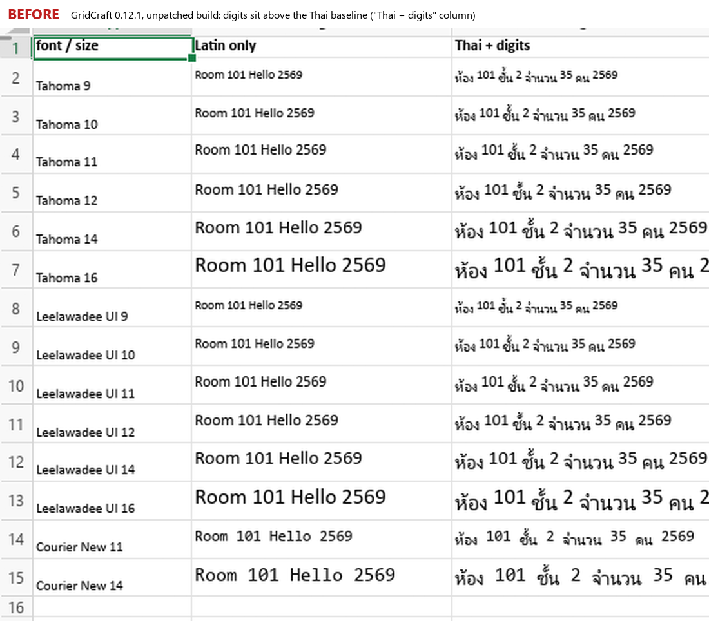

# GridCraft Thai patches (unofficial)

Patches, reproduction workbooks and notes for **Thai-language bugs in
[GridCraft](https://github.com/storytold/gridcraft)**, the open-source spreadsheet. This is an independent
community effort, not affiliated with the ArtCraft team. The aim is to land fixes **upstream**; this repo
is where people can work on them and share patches meanwhile.

- [`BUGS-TH.md`](BUGS-TH.md) — every Thai bug found so far, with evidence, root cause or lead, and status.
- [`patches/`](patches/) — patches against upstream (`git apply`), one bug each.
- [`tests/workbooks/`](tests/workbooks/) — scripts that generate small `.xlsx` files reproducing each bug
  (`pip install openpyxl`).
- [`tools/shot_gridcraft.ps1`](tools/shot_gridcraft.ps1) — Windows helper: opens a workbook in GridCraft and
  saves a screenshot of its window. [`tools/compare_shots.py`](tools/compare_shots.py) puts two shots side by side.
- [`.github/workflows/`](.github/workflows/) — builds and tests every patch on GitHub, so nobody needs a Rust
  toolchain on their own PC (see below).

## The bug, as seen in GridCraft 0.12.1



*Before: the unpatched 0.12.1 build, workbook from [`make_fonttest_sizes.py`](tests/workbooks/make_fonttest_sizes.py).
In every row of the right-hand column, the digits and Latin letters sit higher than the Thai around them. The
font names in column A are the ones set in the file; whether GridCraft applied them is unconfirmed (see #7 in
[`BUGS-TH.md`](BUGS-TH.md)), but the float shows either way.*

**After: no screenshot yet.** Patch 0001 has not been built, so there is nothing honest to show. The *Build and
test* workflow below produces a before/after pair; once someone has looked at it and it is right, it goes here.

## Status

| Patch | Fixes | State |
|-------|-------|-------|
| `0001-script-fallback-faces-sit-on-the-baseline` | digits floating above Thai/CJK text (#502, #1265) | drafted from source reading, **not yet compiled or run**. The workflows below are written but have not run either |

Everything else in `BUGS-TH.md` is open for anyone to pick up. Unbuilt patches are marked as such; please
do not assume a patch works until someone has built it and looked at the result.

## Building and testing on GitHub (no local Rust needed)

Push this folder to a GitHub repository, then open the **Actions** tab.

| Workflow | Start | What it does |
|----------|-------|--------------|
| **Build and test** | automatic on a push or pull request that touches `patches/`, `tests/`, `tools/` or `.github/`; or *Run workflow* | applies every `patches/*.patch` to upstream `11bb673`, runs the `theme::` tests, builds Windows x64 `gridcraft.exe` + `gridcraft-cli.exe` **twice** (plain upstream and patched) and uploads both as artifacts. A best-effort job also screenshots the same Thai workbook in each build |
| **Upstream gate** | *Run workflow* only | runs upstream's own `cargo xtask ci` (fmt, clippy `-D warnings`, tests, wasm check) on Linux with the patches applied. This is the bar `AGENTS.md` sets for a pull request |

To see whether a patch works:

1. Run **Build and test** and wait for it to finish (a cold first run is long; later runs reuse the cache).
2. Download the artifacts `gridcraft-windows-x64-upstream` and `gridcraft-windows-x64-patched` and unzip them.
   They are unsigned test builds (`BUILD-INFO.txt` inside says exactly what went into each), so Windows
   SmartScreen may warn.
3. Make the test workbook and photograph both builds on a normal PC:
   ```powershell
   pip install openpyxl pillow
   python tests\workbooks\make_fonttest_sizes.py thai.xlsx
   .\tools\shot_gridcraft.ps1 -Exe .\upstream\gridcraft.exe -File "$PWD\thai.xlsx" -Out before.png
   .\tools\shot_gridcraft.ps1 -Exe .\patched\gridcraft.exe  -File "$PWD\thai.xlsx" -Out after.png
   python tools\compare_shots.py before.png after.png compare.png
   ```
   In `before.png` the digits and Latin letters in the "Thai + digits" column sit higher than the Thai; in
   `after.png` they should sit on the same baseline. Opening the files by hand and looking is just as good.
4. Run **Upstream gate** with the patches ticked. Only when it is green, and the screenshot looks right, is the
   patch ready to send upstream.

**Cost.** GitHub Actions is free for public repositories. On a private repository Windows minutes count double
against the monthly allowance, and one full run builds the whole app twice. Nothing in this repository is
private, so public is fine. The workflows use no secrets and publish nothing; their output is
downloadable artifacts, kept 14 days.

**Adding a patch.** Put `NNNN-short-name.patch` (a `git diff` against upstream) in `patches/`; patches are
applied in file-name order. If upstream moves on, run **Build and test** with *upstream_ref* set to a newer
commit, and check `craft-fonts-ref` in the workflows against upstream's `ci.yml`.

## Trying a patch by hand

```bash
git clone https://github.com/storytold/gridcraft.git
cd gridcraft
git checkout 11bb673            # the commit the patches were made against
git apply ../th-patches/patches/0001-script-fallback-faces-sit-on-the-baseline.patch
cargo xtask ci                  # upstream's gate: fmt, clippy -D warnings, tests, assets, layers
```

Upstream's `AGENTS.md` sets the bar for contributions: no `unwrap`/`panic` in non-test code, a regression
test with every fix, and `cargo xtask ci` clean. Please follow it, and open pull requests upstream.

## License

Upstream GridCraft is dual-licensed under [MIT](LICENSE-MIT) or [Apache-2.0](LICENSE-APACHE), at your
option; copies of both licences are included because the patches contain upstream code. Nothing here carries
the ArtCraft name, wordmark or logos: upstream says these are trademarks that are not covered by the licence
and that forks and modified versions must remove them. Keep it that way if you fork.

---

## ภาษาไทย (สรุป)

โฟลเดอร์นี้รวมแพตช์ สคริปต์สร้างไฟล์ทดสอบ และบันทึกบั๊กภาษาไทยของ GridCraft (ตัวเลขลอยเหนือตัวอักษรไทย,
export PDF ไม่มีตัวอักษรไทย, ฟังก์ชัน THAIYEAR/ROUNDBAHTUP ฯลฯ ใช้ไม่ได้, รูปแบบวันที่ พ.ศ., การเรียงลำดับสระนำ,
การตัดคำเมื่อ Wrap Text) เป็นงานของชุมชน ไม่เกี่ยวข้องกับทีม ArtCraft เป้าหมายคือส่งแก้ที่ upstream
อ่านรายละเอียดและสถานะของแต่ละบั๊กใน [`BUGS-TH.md`](BUGS-TH.md)

**สถานะแพตช์:** `0001` (ตัวเลขลอย) เขียนจากการอ่านซอร์สแล้ว **ยังไม่ได้คอมไพล์หรือรัน** ต้องมีคน build และดูผลก่อน

**ภาพ:** ภาพ before ด้านบนคือ GridCraft 0.12.1 ตัวเดิมที่ยังไม่แก้ (ตัวเลขลอยสูงกว่าตัวอักษรไทย) ส่วนภาพ after ยังไม่มี
เพราะแพตช์ยังไม่ได้ build จะใส่เมื่อมีคน build และตรวจแล้ว

**ไม่ต้องลง Rust เอง:** push โฟลเดอร์นี้ขึ้น GitHub แล้วไปแท็บ Actions รัน *Build and test* จะได้ GridCraft
สองตัว (ของ upstream เดิม กับตัวที่ใส่แพตช์) ให้ดาวน์โหลดมาเทียบหน้าจอกันเอง ส่วน *Upstream gate* รันชุดตรวจ
`cargo xtask ci` ของ upstream ก่อนส่ง pull request ไฟล์ workflow เขียนแล้วแต่ **ยังไม่เคยรันจริงบน GitHub**
